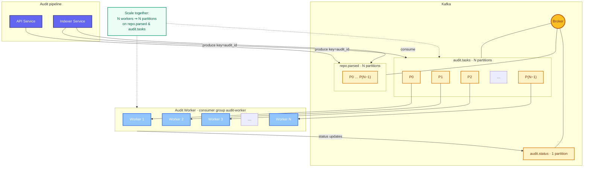

# Kafka scaling — partitions and Audit Workers

**Rule:** parallel audits ≈ **`audit.tasks` partition count**.  
**Message key:** `audit_id` — one audit stays on one partition (ordering per audit).

**MVP today:** N = **5** on `repo.parsed` and `audit.tasks` → up to **5 workers** processing different audits in parallel. Need more throughput → raise **N** (partitions) and worker **replicas** together.
