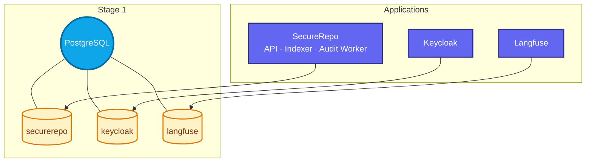
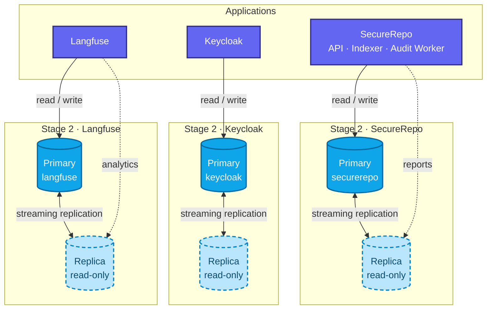
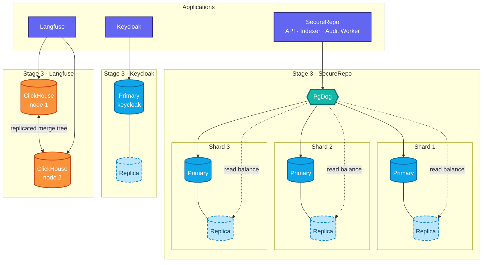

# PostgreSQL in SecureRepo — three scaling stages

## Stage 1 · single PostgreSQL, three databases

---

## Stage 2 · dedicated PostgreSQL per service + read replicas

---

## Stage 3 · PgDog sharding, ClickHouse for Langfuse, replicas retained

