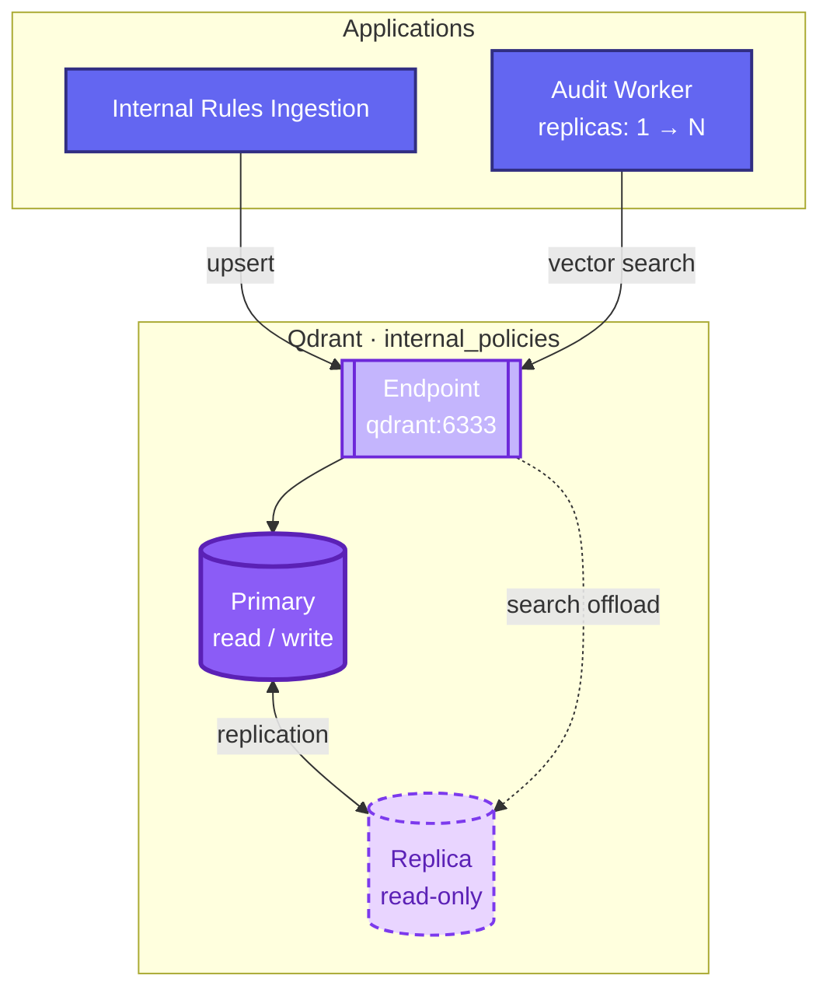

# Qdrant scaling — primary and replica

Collection: **`internal_policies`** (corporate rules, 1024-dim BGE-m3).  
Code chunks are not stored in Qdrant today (Kafka + PostgreSQL `symbols`).

**Note:** target HA layout; MVP deploys a **single Qdrant pod** until search load requires a replica.
