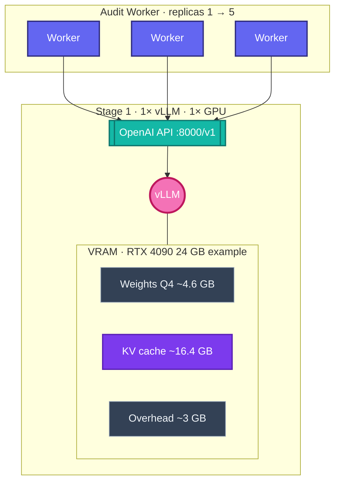
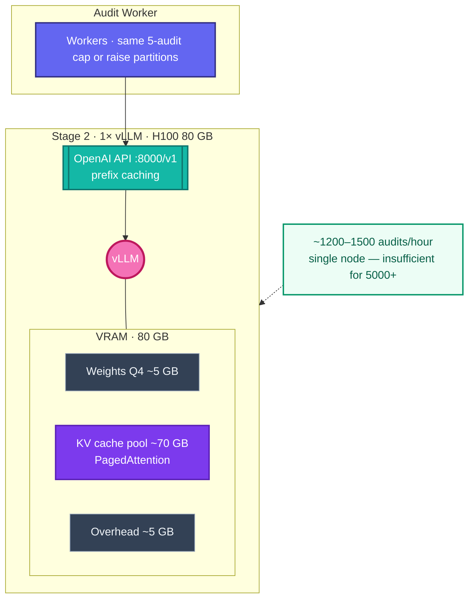
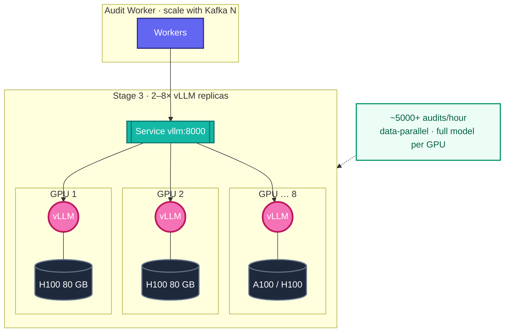

# vLLM scaling — three stages

**Stack:** vLLM · **Qwen2.5-Coder-7B-Instruct** (Q4_K_M / AWQ) · OpenAI-compatible API · **Audit Worker** client.

Throughput figures from [LLM resource estimation](../en/RESOURCES.md#llm-resource-estimation). Product limit: **5 parallel audits** (FR-1.2 / FR-1.3) unless Kafka partitions and workers scale with GPU capacity.

---

## Stage 1 · MVP · one consumer GPU

**Hardware:** 1× **RTX 3070 8 GB** (min) or **RTX 4090 24 GB** (reference).  
**Throughput:** ~**40–300 audits/hour**.

---

## Stage 2 · growth · one datacenter GPU (H100)

Still **one vLLM pod** — more KV headroom and batch capacity; **not** enough alone for enterprise SLA.

**Hardware:** 1× **H100 80 GB**.  
**Throughput:** ~**1200–1500 audits/hour** — next step is **horizontal** GPU replicas (Stage 3).

---

## Stage 3 · enterprise · multi-GPU fleet

**Hardware:** **2–8× H100 80 GB** or **8× A100+** (RESOURCES enterprise).  
**Throughput:** **5000+ audits/hour** aggregate.

---

| Stage | GPUs | vLLM pods | Throughput (indicative) |
|-------|------|-----------|-------------------------|
| 1 | 1× RTX 3070 / 4090 | 1 | 40–300 /h |
| 2 | 1× H100 80 GB | 1 | 1200–1500 /h |
| 3 | 2–8× H100 or 8× A100+ | N | 5000+ /h |

Use **`--enable-prefix-caching`** from Stage 2 onward when internal-rule prefixes repeat across chunks.
